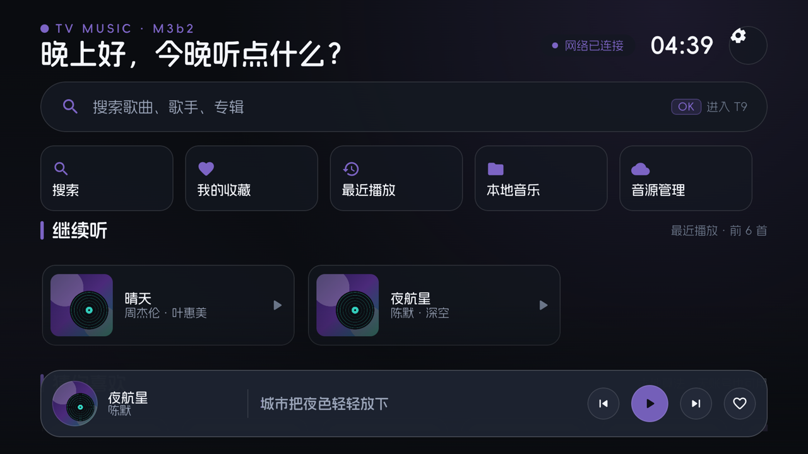
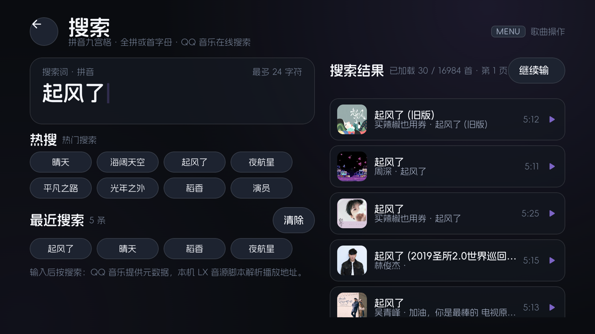

# TV Music

一款面向 Android TV / 电视盒子的在线音乐播放器，用 **Kotlin + Jetpack Compose for TV + Media3** 构建，全流程遥控器操作。

## 界面预览

| 首页 | 播放页 |
|---|---|
|  |  |

| 播放队列 | 搜索 |
|---|---|
|  |  |

## 功能

- **大屏焦点交互**：焦点环、焦点记忆与返回恢复，跨 Rails 保持列索引，浮层 5 秒自动沉浸
- **在线搜索**：拼音九宫格 T9、联想候选、热搜与历史、结果分页
- **在线播放**：LX 音源脚本解析取流，多源轮询与手动换源，MediaSession 后台播放与媒体键
- **热门榜单**：QQ 音乐热歌 / 飙升榜与网易云飙升 / 热歌榜，整榜播放、下一首播放与加入队列
- **首页推荐**：继续听与猜你喜欢，按最近播放歌手在本地生成，无账号也可用
- **横屏歌词动效**：动感涟漪 / 简约 / 精简时钟，封面动态取色、歌词偏移与手动匹配
- **播放队列**：OK 切歌，MENU 上移 / 下移 / 置顶 / 删除；搜索结果可下一首播放或加入队列，队列标记来源
- **本地音乐**：设备媒体库、文件夹导入、SMB2/3 只读流式播放、歌曲下载与离线播放
- **账号**：网易云扫码登录、Cookie 导入、我的歌单整单播放
- **手机伴侣**：局域网网页遥控、搜索输入同步、播放/进度/队列控制
- **音源管理**：脚本导入与市场、逐源取流测试
- **在线更新**：应用内检查、下载、校验与应用内安装入口

## 技术栈

| 组件 | 版本 | 说明 |
|---|---|---|
| Gradle | 8.14.3 | |
| AGP | 8.11.0 | |
| Kotlin | 2.4.21 | Compose 编译器插件 |
| compileSdk / targetSdk | 36 | |
| minSdk | 28 | |
| Compose UI | 1.10.3 | |
| Compose for TV | 1.1.0 | |
| 播放内核 | Media3 1.10.1 | `MediaSessionService` + `MediaController` |
| 音源引擎 | LX QuickJS | `wang.harlon.quickjs:wrapper-android` |
| 字体 | 阿里妈妈方圆体 | 可变字体，全局界面字体 |

## 构建

前置：JDK 17、Android SDK（platform 36、build-tools 36）。

```bash
./gradlew :app:assembleDebug
./gradlew :app:assembleRelease
```

产物：

- Debug：`app/build/outputs/apk/debug/app-debug.apk`（包名 `tv.music.player.debug`）
- Release：`app/build/outputs/apk/release/app-release.apk`（包名 `tv.music.player`）

```bash
adb install -r app/build/outputs/apk/release/app-release.apk
```

## 已知约束

- 在线播放依赖用户自行准备并导入的 LX 音源脚本；本仓库不附带音源脚本、音频或歌词文件
- 在线接口为非官方接口，可能受平台风控、地域与版权限制影响
- 手机伴侣为局域网明文 HTTP + 配对码，仅限可信网络，不要暴露到公网
- 在线更新要求更新包与已安装版本使用同一签名，且需要用户在系统安装器中确认
- 首次使用本地音乐需要在系统里授予音频读取权限；SMB 依赖局域网可达

## 致谢

| 项目 | 作用 |
|---|---|
| [XiangsuPlayerHQ](https://github.com/r3n011/XiangsuPlayerHQ) | LX QuickJS 引擎、HTTP 客户端与脚本存储 |
| [Daily Music](https://github.com/Zxxy326/daily-music) | 横屏歌词动效的绘制实现参考 |
| [AndroidX Media3](https://github.com/androidx/media) | 播放内核 |
| [Compose for TV](https://developer.android.com/jetpack/androidx/releases/tv) | 大屏组件与主题 |
| [QuickJS-Android](https://github.com/wangharlon/QuickJS-Android) | QuickJS 的 Android 封装 |
| [jcifs-ng](https://github.com/AgNO3/jcifs-ng) | SMB2/3 客户端 |
| [ZXing](https://github.com/zxing/zxing) | 二维码生成 |
| 阿里妈妈方圆体 | 全局字体，阿里巴巴免费商用字体 |

## 许可证与免责声明

- 本项目以 **GNU General Public License v3.0** 发布，见 [LICENSE](LICENSE)；第三方组件与字体声明见 [NOTICE](NOTICE)。
- 项目对接的是**非官方**接口，涉及的音乐内容版权归原权利人所有。仅供个人学习与自用，请在合法授权范围内使用。
- 使用本项目产生的一切后果由使用者自行承担。
